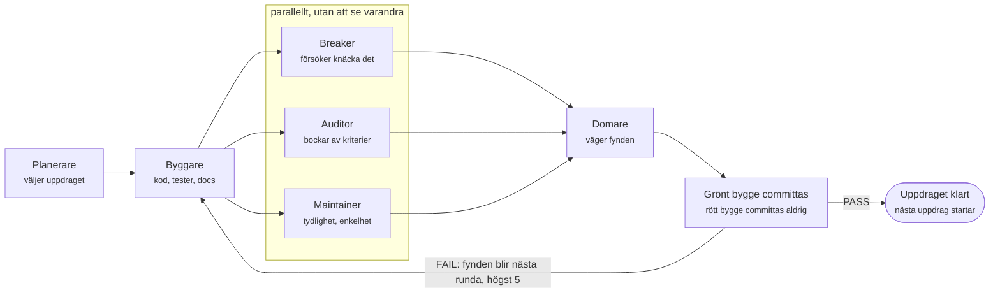

# Spola – säljmaterial

*Ola Karlsson · läget 2026-10-19*

> Det här är en övning i att presentera ett hobbyprojekt. Spola är version 0.x, skrivet av
> AI-agenter och inte redo för produktion. Spola har ingen koppling till Spring, VMware eller
> Broadcom; Spring och Spring Boot är varumärken som tillhör Broadcom Inc.

## Pitch

**Spola är ett Java 25-ramverk som gör det ett webb-API behöver från Spring Boot och Lombok, men utan magi och utan ett enda beroende utanför JDK:n.** Allt som kopplar ihop din applikation står i vanlig Java-kod som du kan följa med "Go to definition".

Tre budskap bär allt annat:

1. **Inget dolt.** Inga annoteringar som gör saker i bakgrunden, ingen classpath-scanning, ingen reflektion i uppstarten. Det du läser är det som körs.
2. **Fel tidigt, inte i produktion.** Saknade beroenden, cykler och felaktig konfiguration upptäcks av kompilatorn eller vid start, alla på en gång och med rad angiven.
3. **Noll tredjepartsberoenden.** Inga transitiva bibliotek att bevaka för sårbarheter och inga versionskonflikter mellan dem. Bara JDK 25.

## Avvägningen

Spring Boot och Lombok sparar mycket tid, och för de flesta team är de rätt val. Priset är konventioner och beroenden, och det märks på fyra ställen. Spola är ett experiment med den andra avvägningen:

- **Magi som måste läras ut.** En klass blir en böna för att den har rätt annotering och ligger i rätt paket. Nya utvecklare lär sig konventioner i stället för kod, och "Go to definition" leder till ramverket, inte till svaret.
- **Fel som syns sent.** Ett saknat beroende eller en cykel märks först när kontexten startar, och felet pekar på en klass, inte på var kopplingen gjordes.
- **En lång beroendekedja.** Varje startprojekt drar in hundratals transitiva bibliotek. Varje sårbarhet i något av dem blir ditt problem, och varje uppgradering kan ge versionskonflikter.
- **Kod som inte finns.** Lombok genererar metoder som inte syns i källkoden och kräver stöd i både kompilator och IDE.

## Lösningen

Spola behåller det Spring gör bra, alltså en helhet från konfiguration till HTTP och säkerhet, men byter magin mot explicit Java 25. Fem principer styr varje modul och kontrolleras automatiskt i bygget:

| Princip | I praktiken |
| --- | --- |
| Bara JDK 25 | Inga tredjepartsbibliotek, ingen Maven eller Gradle. Bygget körs med `java Build.java`. |
| Explicit framför magiskt | All wiring är vanlig kod. Ingen scanning, inga namnkonventioner. |
| Sex tillåtna annoteringar, resten förbjudna | Bara JDK:ns egna, som `@Override`. Inga egna annoteringstyper. |
| Kompileringsfel framför runtime-fel | Records, sealed interfaces och lambdas i stället för reflektion. |
| Varje modul fristående | Ta med DI utan HTTP, eller JSON utan resten. |

Reglerna är inte bara ord: en guardrails-modul i bygget stoppar en otillåten annotering, en främmande import eller en inlagd jar-fil med fil och rad.

## Så ser det ut

Samma orderservice, med ett repository och en av två betalningstjänster. I Spring hittas klasserna genom scanning och kopplas med annoteringar:

```java
@Component
class OrderService {
    @Autowired
    OrderService(OrderRepo repo, @Qualifier("eu") PaymentGateway gateway) { ... }
}
var context = new AnnotationConfigApplicationContext("shop");
```

I Spola står kopplingen i koden. Klasserna har inga annoteringar och vet inget om containern:

```java
record OrderService(OrderRepo repo, PaymentGateway gateway) { }

ContainerModule orders = binder -> {
    binder.bind(Key.of(PaymentGateway.class, Region.EU)).to(EuGateway::new);
    binder.bind(OrderRepo.class).to(DataSource.class, JdbcOrderRepo::new);
    binder.bind(OrderService.class).to(
            Key.of(OrderRepo.class), Key.of(PaymentGateway.class, Region.EU), OrderService::new);
};
try (var container = Container.create(orders, configModule)) { ... }
```

Saknas en koppling stoppar `Container.create` innan något har skapats och pekar på raden:

```text
spola.di.WiringException: the container has 1 wiring problem:
  - shop.OrderService (bound at shop.Modules.lambda$orders$1(Modules.java:14)) depends on shop.OrderRepo, which is not bound
```

Konfigurationen fungerar likadant. Du anger källorna och deras ordning i koden, binder till records och får alla fel i ett enda undantag vid start. Lösenord maskeras i felmeddelanden.

## Vad som finns i dag

Fjorton moduler med 3 568 tester, cirka 39 000 rader källkod och 40 000 rader test (med kommentarer och Javadoc). Allt bygger grönt med `java Build.java`. Det räcker för ett webb-API med HTTPS, JSON, validering, inloggning med session och CSRF-skydd, och för att anropa andra JSON-API:er.

| Modul | Ersätter | Tester |
| --- | --- | --- |
| `spola.web` | Spring MVC: routing som kod, filter, felhantering, JSON, cookies, formulär, sessioner, proxyhuvuden | 1 156 |
| `spola.client` | Springs `RestClient`: JSON-API:er över `java.net.http`, utan att läcka nycklar i fel | 447 |
| `spola.json` | Jackson: strikt RFC 8259-parser och explicit mappning till records | 417 |
| `spola.security` | Spring Security (kärna): PBKDF2- och BCrypt-hashning, autentisering | 346 |
| `spola.http` | Tomcat/Netty: HTTP/1.1 på virtuella trådar, TLS, gränser mot missbruk | 290 |
| `spola.security.web` | Spring Security (webb): filter, HTTP Basic, åtkomstregler, inloggning med session, CSRF | 287 |
| `spola.validation` | Bean Validation: komponerbara validatorer och felrapporter | 251 |
| `spola.util` | Lombok och Spring-loggning: `Log`, `Lazy`, `ToString` | 80 |
| `spola.test` | JUnit: tester som lambdas | 77 |
| `spola.config` | `application.properties`, `@Value`, profiler | 68 |
| `spola.di` | Spring Core: explicit DI, scopes, livscykel | 48 |
| `spola.demo` | Exempelprogram som använder modulerna tillsammans | 43 |
| `spola.codegen` | Lombok `@Builder`, `@With`: genererad källkod | 41 |
| `spola.guardrails` | Regelkontroller i bygget | 17 |

## Hur det byggs

Spola byggs av en loop med AI-agenter där ingen godkänner sitt eget arbete. En byggare skriver koden, tre kritiker med färsk kontext försöker sänka den, och en domare väger fynden.



Bara rundor där bygget och alla tester går grönt committas, så varje version i historiken fungerar. Hittills har 29 uppdrag passerat loopen sedan starten den 2 oktober 2026. Varje beslut finns spårbart i git och i körningsloggarna.

## Vem det kan intressera

Spola är ett experiment, inte ett ramverk att bygga en verksamhet på. Det kan intressera den som hellre skriver tre rader till än lär sig en konvention.

| Läsare | Vad det finns att hämta |
| --- | --- |
| Den som vill se hur långt JDK:n räcker | Ett webb-API med HTTPS, JSON, validering, sessioner och CSRF-skydd utan ett enda bibliotek utanför JDK 25. |
| Den som vill förstå ett ramverk inifrån | Ingen dold magi. "Go to definition" leder hela vägen, och felmeddelanden pekar på rätt rad. |
| Den som är nyfiken på AI-agenter som skriver kod | Varje uppdrag, kritik och utslag finns i `gauntlet/runs/`, och inget committas utan grönt bygge. |
| Drift och plattform | Moduler utan beroenden kan packas med `jlink` till en egen liten Java-runtime. Ingen scanning eller reflektion vid uppstart. |
| Den som vill se modern Java | Records, sealed interfaces, virtuella trådar och scoped values används fullt ut, inte som tillägg till ett äldre ramverk. |

Priset är lite mer kod på de ställen där Spring gissar, till exempel i kopplingen mellan komponenter och i JSON-mappningen. Integrationstestet visade var det blir ordrikt, och de punkterna byggs bort när ett projekt behöver det.

## Ärligt läge och hur det växer

Spola är version 0.x och inte redo för produktion än. Ramverket byggs efter behov: när ett projekt som använder Spola behöver något som Spring eller Lombok har, beställs det med koden projektet vill kunna skriva, och loopen bygger det.

| Område | Läge |
| --- | --- |
| Bygge, test, DI, konfiguration, util, JSON | Klart |
| HTTP-server med TLS, web, validering, HTTP-klient | Klart |
| Säkerhet: PBKDF2 och BCrypt, filter, Basic, åtkomstregler, inloggning med session, CSRF | Klart, väntar på mänsklig granskning |
| Omförsök vid tillfälliga fel (Spring Retry) | Beställt av ett projekt, inte byggt än |
| JWT, PostgreSQL, schemaläggning, observability, starter | Idéer, byggs när ett projekt behöver dem |

Kända begränsningar:

- **Säkerhetskoden ska granskas av en människa** innan den används på riktigt. Loopen har redan hittat och rättat ett sådant fel: en metodregel med gemener, som `method("get")`, matchade aldrig och släppte igenom anropet till nästa regel.
- **Leverans via GitHub-releaser.** Varje version publiceras med en jar och en källkods-jar per modul och `SHA256SUMS`. Det finns inget Maven-repo, så projekten hämtar jar-filerna själva.
- **DI blir ordrik** när ett beroende har en kvalificerare, eftersom alla beroenden då måste skrivas som `Key`. En API-förbättring är planerad.
- **Skrivet av AI-agenter.** Koden är skriven och granskad av agenterna i loopen. Testerna och reglerna i bygget är skyddsnätet, men ingen människa har läst all kod.
- **Bygget tar några minuter** och växer med testerna.

## Nästa steg

Det snabbaste sättet att bedöma Spola är att läsa en modul bredvid sin Spring-motsvarighet. Varje modul har en README med båda sidor.

1. **Läs:** börja med [`modules/di/README.md`](../framework/modules/di/README.md) och [`modules/demo/README.md`](../framework/modules/demo/README.md), som har en ärlig friktionsrapport från integrationen.
2. **Kör:** med JDK 25 installerat bygger och testar `java Build.java` i `framework/` hela ramverket utan något annat verktyg.
3. **Prova:** kör demoprogrammet med `java -p framework/out/classes -m spola.demo/spola.demo.InventoryApp`.
4. **Bidra:** säkerhetsgranskning av modulerna 10–13 och synpunkter på API:ernas ergonomi gör störst skillnad just nu.
